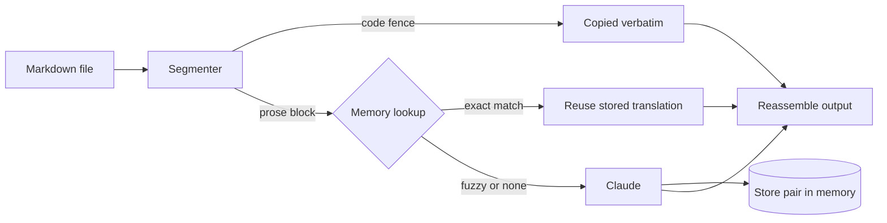

# LLM RAG Translator

Translate Markdown manuals with Claude, backed by a RAG translation memory.

> [!CAUTION]
> **One-shot demo code. Not production software.**
>
> This repository is a proof of concept written to explore an idea in a single pass. It is
> provided **as is, without warranty and without support**. It has had no security review, no
> load testing, and only minimal automated tests. Interfaces, storage schemas and defaults may
> change or break without notice, and there is no migration path between versions.
>
> Before you point it at real content, understand that:
>
> - **Your text is sent to the Anthropic API** for every segment that is not reused from memory,
>   and **API calls are billed to your account**. Check the cost on a small file first.
> - **Translations are machine output and are not reviewed.** Do not publish legal, medical,
>   safety-critical or contractual text without a human translator reading it.
> - The default Postgres credentials in `docker-compose.yml` (`tm` / `tm`) are for local
>   experiments only. Never expose that database.
> - The default embedding model is local and English-leaning. It is a placeholder, not a
>   recommendation for multilingual corpora (see [Limitations](#limitations)).
>
> Treat this as a reference for ideas and a starting point to rewrite, not as a dependency.

## Contents

- [Overview](#overview)
- [How it works](#how-it-works)
- [Requirements](#requirements)
- [Quick start](#quick-start)
- [Usage](#usage)
- [Configuration](#configuration)
- [Translation memory backends](#translation-memory-backends)
- [Project layout](#project-layout)
- [Cost model](#cost-model)
- [Limitations](#limitations)
- [Further reading](#further-reading)
- [License](#license)

## Overview

A translation memory is retrieval-augmented generation applied to translation. This tool splits a
Markdown manual into segments and, for each one, retrieves the closest previously translated
segments from a vector store. It then does one of two things:

| Match | Behaviour | Model call |
| --- | --- | --- |
| **Exact** (nearest neighbour is byte-identical and within cosine distance 0.05) | Reuses the stored translation verbatim. | None |
| **Fuzzy** (neighbours within cosine distance 0.35) | Sends the similar past translations to Claude as references, so terminology and style stay consistent. | One |
| **No match** | Translates the segment from scratch. | One |

Re-running the tool on an edited manual therefore only pays for the paragraphs that changed.

Code fences, URLs, file paths and inline code are never translated. A JSON glossary pins the
translation of specific terms.

## How it works

Only one kind of call is networked and billed: the Claude API. Segmentation, embeddings and the
vector store all run locally.



1. **Segment** (`segmenter.py`). The document is walked line by line. A fenced code block
   (opened by <code>```</code> or `~~~`) becomes one non-translatable segment. Everything else is split on
   blank lines into blocks (a heading, a paragraph, a list, a table). Segmentation is lossless:
   concatenating every segment reproduces the input byte for byte.
2. **Look up** (`translator.py`, `backends/`). Each translatable block is embedded locally and
   compared with stored sources for the same language pair.
3. **Decide.** An exact hit is reused with no model call. Otherwise neighbours within the fuzzy
   threshold become reference examples.
4. **Translate.** `messages.create` is called with the segment and any references. The system
   prompt (rules and glossary) is identical for every segment and is marked for prompt caching.
5. **Remember.** The new source-to-translation pair is written to the memory, with the translator
   model and an `origin` of `machine`.
6. **Reassemble.** Segments are joined in order and the output is written once at the end.

## Requirements

- Python 3.10 or later
- An [Anthropic API key](https://console.anthropic.com/)
- Optional: Docker, for the Postgres/pgvector backend

On NixOS, the pip wheels behind ChromaDB (numpy, onnxruntime) need `libstdc++` on the library
path. Enter a shell that provides it (for example one exporting `LD_LIBRARY_PATH` with
`stdenv.cc.cc.lib`, `zlib` and `glib`) before using the virtual environment.

## Quick start

```bash
python -m venv .venv && source .venv/bin/activate
pip install -r requirements.txt        # or: pip install -e .
cp .env.example .env                   # then set ANTHROPIC_API_KEY
```

Translate the bundled example:

```bash
python -m translate_manual.cli translate examples/sample_manual.md \
    --source English --target French \
    --glossary examples/glossary.fr.json \
    --output examples/sample_manual.fr.md
```

## Usage

After `pip install -e .` the `translate-manual` command is available.

### `translate`

```bash
translate-manual translate INPUT_FILE -s SOURCE -t TARGET [-o OUTPUT] [-g GLOSSARY]
```

| Option | Description |
| --- | --- |
| `-s`, `--source` | Source language, for example `English`. Required. |
| `-t`, `--target` | Target language, for example `French`. Required. |
| `-o`, `--output` | Output file. Defaults to the input name with the suffix replaced by `.<target>.md`. |
| `-g`, `--glossary` | JSON file mapping source terms to target terms. |

Progress and a summary of segment counts (total, translatable, reused from memory, translated by
the model, fuzzy-assisted) are written to standard error.

A glossary is a plain JSON object:

```json
{
  "battery": "batterie",
  "warranty": "garantie"
}
```

### `stats`

```bash
translate-manual stats -s English -t French
```

Prints the number of stored pairs for a language pair.

### `dump`

```bash
translate-manual dump -s English -t French
```

Prints every stored source and translation pair for a language pair.

## Configuration

Configuration is read from the environment, or from a `.env` file (see `.env.example`).

| Variable | Default | Description |
| --- | --- | --- |
| `ANTHROPIC_API_KEY` | none | API key used by the Anthropic SDK. Required. |
| `TM_MODEL` | `claude-opus-4-8` | Claude model used for translation. |
| `TM_BACKEND` | `chroma` | Memory backend: `chroma` or `postgres`. |
| `TM_STORE_DIR` | `.translation_memory` | Where the Chroma backend persists data. |
| `TM_DATABASE_URL` | `postgresql://tm:tm@localhost:13833/tm` | DSN for the Postgres backend. |
| `TM_EMBED_MODEL` | `all-MiniLM-L6-v2` | Embedding model label, recorded on every stored row. |
| `TM_EMBED_DIM` | `384` | Embedding dimension. Sizes the Postgres `vector(N)` column. |

The match thresholds (`EXACT_MATCH_DISTANCE` 0.05, `FUZZY_MATCH_DISTANCE` 0.35,
`FUZZY_MATCH_COUNT` 3) are constants in `translate_manual/config.py`.

## Translation memory backends

Both backends implement the interface in `translate_manual/backends/base.py`
(`lookup`, `store`, `stats`, `all_pairs`), so switching changes nothing in the translation logic.

| `TM_BACKEND` | Store | Intended use |
| --- | --- | --- |
| `chroma` | Embedded Chroma over SQLite in `.translation_memory/` | Development and tests. No infrastructure. |
| `postgres` | pgvector on Postgres, one `tm` table and an HNSW index | A closer model of production: provenance columns, backups, joins to other data. |

### Postgres

`docker-compose.yml` starts pgvector on host port **13833**, chosen to avoid clashing with other
local Postgres instances.

```bash
docker compose up -d
export TM_BACKEND=postgres
# TM_DATABASE_URL defaults to postgresql://tm:tm@localhost:13833/tm

translate-manual translate examples/sample_manual.md -s English -t French
```

The application creates the table and index on first run. Each row records the
`embedding_model` and `embedding_dim` (so a later model swap can be detected), the
`translator_model`, and an `origin` of `machine` or `human_reviewed`.

Entries are keyed by source language, target language and source text. Storing the same source
again overwrites the previous entry.

## Project layout

| Path | Role |
| --- | --- |
| `translate_manual/cli.py` | `translate`, `stats` and `dump` commands. |
| `translate_manual/translator.py` | Per-segment flow: lookup, reuse or call Claude, store. |
| `translate_manual/segmenter.py` | Lossless Markdown segmentation. |
| `translate_manual/config.py` | Environment-driven configuration and thresholds. |
| `translate_manual/embedding.py` | Shared text-to-vector embedder, used by the Postgres backend. |
| `translate_manual/backends/` | Memory interface, Chroma backend, pgvector backend. |
| `db/init.sql` | Enables the `vector` extension on first container start. |
| `docker-compose.yml` | Local pgvector database. |
| `examples/` | A sample manual and a French glossary. |
| `docs/DESIGN_NOTES.md` | Design rationale and findings. |

## Cost model

For a document with *N* translatable segments, of which *K* are exact reuses:

| Operation | Where | Count | Cost |
| --- | --- | --- | --- |
| Read input, segment, write output | local | 1 each | none |
| Embed and query the memory | local | *N* | none |
| Claude `messages.create` | Anthropic API | *N* − *K* | billed; system prompt cached |
| Store a pair in the memory | local or database | *N* − *K* | none |

Segments are translated one at a time, in order.

## Limitations

- **Demo quality.** No retry policy beyond the SDK defaults, no concurrency, and only minimal
  automated tests.
- **Translation direction.** Only the source side is embedded, so a pair stored for English to
  French is not found by a French to English lookup. See `docs/DESIGN_NOTES.md` for options.
- **Embedder.** The default MiniLM model is local, free and English-leaning. For multilingual
  content, replace `embedding.py` with a hosted multilingual embedder and set `TM_EMBED_MODEL`
  and `TM_EMBED_DIM` to match. Writes and queries within one store must use the same model.
- **Review workflow.** The `human_reviewed` origin exists in the schema, but no command sets it
  and lookups do not yet prefer reviewed pairs over machine ones.
- **Markdown coverage.** Segmentation is line and blank-line based. It does not parse Markdown,
  so unusual constructs (for example front matter or HTML blocks) are treated as prose.

## Further reading

- [`docs/DESIGN_NOTES.md`](docs/DESIGN_NOTES.md): the pipeline call by call, what the vector
  store does, the embedding model, the one-table Postgres design, known flaws and production
  recommendations.

## License

MIT.
